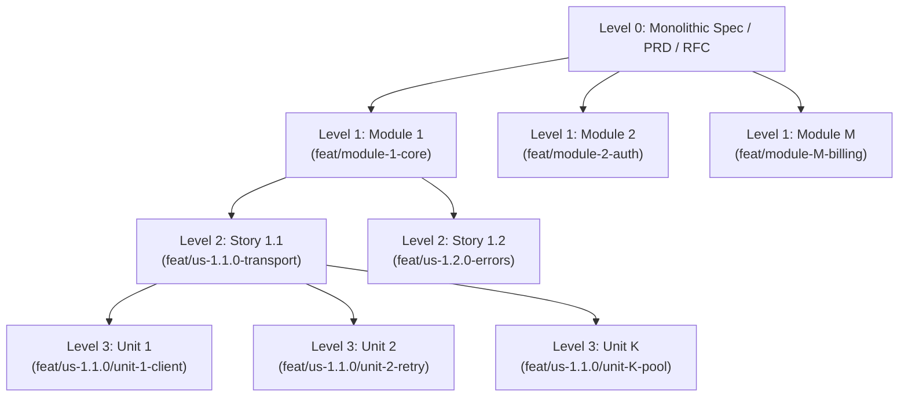
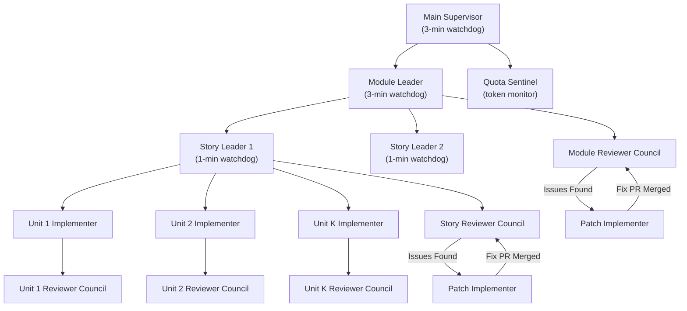
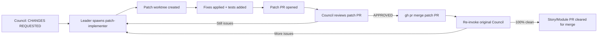

# 📘 Divide-and-Conquer Dev Plugin — Complete User Manual

<div align="center">

**The Official How-to-Use Guide for Google Antigravity, Claude Code & OpenAI Codex**

[](#)
[](#google-antigravity)
[](#claude-code)
[](#openai-codex-cli)
[](#license)

</div>

---

## Table of Contents

1. [What Is This Plugin?](#1-what-is-this-plugin)
2. [Key Concepts & Terminology](#2-key-concepts--terminology)
3. [System Requirements](#3-system-requirements)
4. [Installation](#4-installation)
   - [Google Antigravity](#41-google-antigravity)
   - [Claude Code](#42-claude-code)
   - [OpenAI Codex CLI](#43-openai-codex-cli)
   - [All Platforms at Once](#44-all-platforms-at-once)
5. [Quickstart Tutorial](#5-quickstart-tutorial)
6. [The Decomposition Pipeline](#6-the-decomposition-pipeline)
7. [The Agent Hierarchy](#7-the-agent-hierarchy)
8. [The 6 Quality Gates](#8-the-6-quality-gates)
9. [Command Reference](#9-command-reference)
10. [Script Reference](#10-script-reference)
11. [Skill Reference](#11-skill-reference)
12. [Agent Roster (283 Specialists)](#12-agent-roster-283-specialists)
13. [GitHub Projects Kanban & Checkpoints](#13-github-projects-kanban--checkpoints)
14. [Token Management & Quota Sentinel](#14-token-management--quota-sentinel)
15. [Platform-Specific Notes](#15-platform-specific-notes)
16. [Troubleshooting](#16-troubleshooting)
17. [FAQ](#17-faq)
18. [License & Acknowledgments](#18-license--acknowledgments)

---

## 1. What Is This Plugin?

`divide-and-conquer-dev-plugin` is a **language-agnostic, autonomous multi-agent software engineering plugin** that works across three AI coding platforms:

- **Google Antigravity** (AGY / Gemini)
- **Claude Code** (Anthropic)
- **OpenAI Codex CLI**

It takes a monolithic specification document (PRD, RFC, architecture doc, research paper) and:

1. **Decomposes** it into Modules → User Stories → Implementation Units
2. **Executes** all units in parallel inside isolated Git worktrees
3. **Reviews** every PR through independent multi-council code review
4. **Self-corrects** any issues via dedicated `patch-implementer` agents
5. **Tracks** everything on GitHub Projects Kanban with in-PR audit trails

> [!IMPORTANT]
> This plugin consumes a **high volume of tokens** because it runs parallel agents and multi-council reviews. It is **optimized for the Gemini Flash family** but works on any model that supports subagent spawning.

---

## 2. Key Concepts & Terminology

| Term | Definition |
| :--- | :--- |
| **Module** | A bounded architectural subsystem (e.g., "Auth", "Billing", "Core Runtime"). Branch: `feat/module-M-<slug>` |
| **User Story** | A cohesive feature deliverable within a module. Branch: `feat/us-M.S.0-<slug>` |
| **Implementation Unit** | An atomic, self-contained vertical code slice with its own tests. Branch: `feat/us-M.S.0/unit-N-<slug>` |
| **$K$** | The dynamically calculated number of units per story (can be 1–8+, not fixed at 5) |
| **Worktree** | An isolated Git checkout in `.worktrees/` where each unit is built independently |
| **Code Reviewing Council** | An independent reviewer agent that audits PRs against 6 quality gates |
| **Patch Implementer** | A dedicated remediation agent spawned when a review council flags issues |
| **Gate G0–G-Review** | The 6 mandatory quality gates every PR must pass before merge |
| **Quota Sentinel** | An autonomous agent that monitors token usage and pauses before hitting limits |
| **Cascading Merge** | Ordered merge sequence ($1 → 2 → … → K$) via `gh pr merge` |

---

## 3. System Requirements

### Mandatory (Hard Blockers)

| Requirement | Minimum Version | How to Verify |
| :--- | :--- | :--- |
| **Git** | ≥ 2.30 (for `git worktree`) | `git --version` |
| **GitHub CLI (`gh`)** | ≥ 2.30 | `gh --version` |
| **`gh` authentication** | — | `gh auth status` |
| **GitHub repository** | — | `git remote -v` |

### Recommended

| Requirement | Purpose |
| :--- | :--- |
| **Python 3** | Used by `gh-kanban-sync.sh` for JSON manipulation |
| **GitHub Projects v2** | For visual Kanban board tracking |
| **Gemini Flash model** | Optimal cost/speed for parallel multi-agent execution |

### Verify Everything at Once

```bash
./scripts/preflight-check.sh
```

If anything is missing, the plugin will **refuse to start** and tell you exactly what to install.

### First-Time Setup Checklist

```bash
# 1. Install Git (if missing)
# macOS:  brew install git
# Ubuntu: sudo apt install git
# Windows: https://git-scm.com/downloads

# 2. Install GitHub CLI (if missing)
# macOS:  brew install gh
# Ubuntu: sudo apt install gh
# Windows: winget install GitHub.cli

# 3. Authenticate GitHub CLI
gh auth login -s repo,project,read:project

# 4. Verify
./scripts/preflight-check.sh
# ✅ Found git version 2.43.0
# ✅ Found gh version 2.62.0
# ✅ GitHub CLI (gh) is authenticated
# ✅ All required tools verified. Ready to start.
```

---

## 4. Installation

### 4.1 Google Antigravity

**Option A: Clone and Install**
```bash
# Clone the plugin
git clone https://github.com/some-of-cs/divide-and-conquer-dev-plugin.git

# Install into your project
./divide-and-conquer-dev-plugin/scripts/install-plugin.sh \
  --tool antigravity \
  --target /path/to/your/project \
  --divisions engineering,security,testing
```

**What gets installed:**
```
your-project/
├── AGENTS.md                          # Plugin governance rules (auto-loaded)
├── .agents/
│   ├── rules/                         # Reference docs for Rules 01–06
│   ├── skills/                        # All 8 skills + security-audit suite
│   ├── agents/                        # Core orchestrators + selected specialists
│   └── checkpoints/                   # Runtime state for quota-sentinel recovery
├── scripts/
│   ├── preflight-check.sh
│   ├── gh-kanban-sync.sh
│   ├── post-pr-report.sh
│   └── select-agents.sh
└── .worktrees/                        # Isolated execution sandbox (empty on install)
```

**Option B: Antigravity Marketplace** (when available)
```bash
agy plugin install some-of-cs/divide-and-conquer-dev-plugin
```

### 4.2 Claude Code

**Option A: Clone and Install**
```bash
git clone https://github.com/some-of-cs/divide-and-conquer-dev-plugin.git

./divide-and-conquer-dev-plugin/scripts/install-plugin.sh \
  --tool claude \
  --target /path/to/your/project \
  --divisions engineering,security,testing
```

**What gets installed:**
```
your-project/
├── AGENTS.md                          # Antigravity/Codex rules
├── CLAUDE.md                          # Claude Code rules (auto-loaded)
├── .agents/                           # Core skills, agents, checkpoints
├── .claude/
│   ├── skills/                        # Mirror of .agents/skills/
│   ├── agents/                        # Mirror of .agents/agents/
│   └── commands/                      # 5 slash commands
│       ├── divide-and-conquer.md
│       ├── decompose-spec.md
│       ├── council-review.md
│       ├── select-agents.md
│       └── kanban-sync.md
├── scripts/                           # Shell tooling
└── .worktrees/                        # Execution sandbox
```

**Option B: Claude Code Marketplace**
```
/plugin marketplace add some-of-cs/divide-and-conquer-dev-plugin
/plugin install divide-and-conquer-dev-plugin@divide-and-conquer-dev-marketplace
```

**Available Slash Commands (Claude Code Only):**
| Command | Description |
| :--- | :--- |
| `/divide-and-conquer <spec>` | Run the full end-to-end pipeline |
| `/decompose-spec <path>` | Decompose a spec into modules/stories/units |
| `/council-review <PR#>` | Run a standalone code review on any PR |
| `/select-agents <options>` | Browse, search, and enable specialist agents |
| `/kanban-sync <init\|status>` | Initialize or update Kanban & checkpoints |

### 4.3 OpenAI Codex CLI

```bash
git clone https://github.com/some-of-cs/divide-and-conquer-dev-plugin.git

./divide-and-conquer-dev-plugin/scripts/install-plugin.sh \
  --tool codex \
  --target /path/to/your/project \
  --divisions engineering,security,testing
```

**What gets installed:**
```
your-project/
├── AGENTS.md                          # Governance rules (Codex reads this automatically)
├── .agents/                           # Core layout (skills, agents, checkpoints)
├── .codex/
│   ├── skills/                        # Mirror of .agents/skills/
│   └── agents/                        # Mirror of .agents/agents/
├── scripts/                           # Shell tooling
└── .worktrees/                        # Execution sandbox
```

**Codex Configuration** (`codex.json` in plugin root):
```json
{
  "instructions": "./AGENTS.md",
  "skills_dir": "./skills",
  "agents_dir": "./agents",
  "preflight_command": "./scripts/preflight-check.sh --quiet"
}
```

### 4.4 All Platforms at Once

```bash
./divide-and-conquer-dev-plugin/scripts/install-plugin.sh \
  --tool all \
  --target /path/to/your/project \
  --divisions engineering,security,testing
```

This installs the Antigravity base layout plus Claude-specific and Codex-specific directories simultaneously.

---

## 5. Quickstart Tutorial

This walkthrough shows how to take a specification document and build it using the plugin. The steps work on all three platforms.

### Step 1: Verify Prerequisites

```bash
cd /path/to/your/project
./scripts/preflight-check.sh
```

### Step 2: Select Your Specialist Agents

Choose the agents that match your project's tech stack:

```bash
# See all 18 available divisions
./scripts/select-agents.sh --list-divisions

# Search for specific expertise
./scripts/select-agents.sh --search "typescript"
./scripts/select-agents.sh --search "rust"
./scripts/select-agents.sh --search "python"

# Enable agents for a TypeScript/React project
./scripts/select-agents.sh \
  --agents frontend-developer,backend-architect,api-tester,application-security-engineer \
  --target .
```

### Step 3: Initialize GitHub Projects Kanban

```bash
./scripts/gh-kanban-sync.sh init \
  --module module-1 \
  --title "Module 1: Core Platform" \
  --project-number 1
```

### Step 4: Launch the Pipeline

**On Claude Code:**
```
/divide-and-conquer docs/SPECIFICATION.md
```

**On Antigravity or Codex** (prompt the agent directly):
```
Using the divide-and-conquer-dev-plugin rules and the spec-decomposition skill:

1. Run ./scripts/preflight-check.sh to verify git and gh are ready.
2. Decompose docs/SPECIFICATION.md into bounded Modules, User Stories,
   and dynamically sized non-blocking Implementation Units.
3. Sync the roadmap with GitHub Project Kanban and .agents/checkpoints/.
4. Execute Module 1 by spawning parallel Story Leaders and Unit Implementers
   in .worktrees/, running parallel Code Reviewing Councils, using
   patch-implementer for any review findings, and posting all reports
   directly to the GitHub PR conversations.
```

### Step 5: Monitor Progress

- **GitHub**: Watch PRs being created, reviewed, and merged automatically
- **GitHub Projects**: See your Kanban board update in real-time
- **Terminal**: The agent reports status through its conversation

### Step 6: Review the Results

When complete, you'll have:
- ✅ All code merged into `main` via cascading PR pipeline
- ✅ Every PR has an audit trail (Implementation Report + Council Sign-Off)
- ✅ Zero compiler warnings, zero linter issues
- ✅ ≥90% test coverage, CC ≤ 6 on primary paths
- ✅ Full security audit documentation

---

## 6. The Decomposition Pipeline

The plugin transforms specs through 4 levels:



### How $K$ (Number of Units) Is Calculated

The number of implementation units per story is **not fixed at 5**. It's calculated using the **Story Decomposition Score**:

$$S_{\text{story}} = 0.35 \times D_1 + 0.25 \times D_2 + 0.20 \times D_3 + 0.20 \times D_4$$

| Dimension | Weight | What It Measures |
| :--- | :---: | :--- |
| $D_1$: Surface Area | 35% | Number of entities, endpoints, or components |
| $D_2$: Code Volume | 25% | Estimated production lines of code |
| $D_3$: Complexity | 20% | Algorithmic/protocol difficulty |
| $D_4$: Boundaries | 20% | Number of naturally independent files/modules |

| Score Range | Units ($K$) | Story Profile |
| :---: | :---: | :--- |
| 1.00–1.25 | 1–2 | Small utility or config slice |
| 1.26–2.00 | 3 | Focused domain model + service + handler |
| 2.01–2.55 | 4 | Medium multi-endpoint feature |
| 2.56–3.10 | 5 | Rich domain story with CRUD + streaming |
| 3.11–3.55 | 6–7 | Large subsystem across 6–7 submodules |
| 3.56–4.00 | 8+ | Mega-story (or split into two stories) |

### Two Iron-Clad Rules for Units

1. **Pure Implementation Only**: Every unit writes real production code + tests. Never create a "test-only" or "validation-only" unit.
2. **Zero Inter-Unit Blocking**: All $K$ units own disjoint files so they execute 100% in parallel without waiting on each other.

---

## 7. The Agent Hierarchy



### The 7 Core Agents

| Agent | Role | Supervision |
| :--- | :--- | :--- |
| **Module Leader** | Spawns Story Leaders, manages module-level review & merge | 3-min watchdog |
| **Story Leader** | Spawns $K$ Unit Implementers, manages story-level review & merge | 1-min watchdog |
| **Unit Implementer** | Builds one vertical slice in an isolated worktree | N/A (leaf agent) |
| **Code Reviewer Council President** | Evaluates all 6 quality gates on a PR | Independent per PR |
| **Patch Implementer** | Fixes issues flagged by a Council in a dedicated branch | Spawned on demand |
| **Git Workflow Master** | Exclusive authority for all Git/GitHub operations | Shared service |
| **Quota Sentinel** | Monitors token usage, pauses & resumes execution | Background daemon |

### Strict Hierarchy Rules

- **Module Leaders** spawn **Story Leaders** only (never Unit Implementers directly)
- **Story Leaders** spawn **Unit Implementers** only
- **Leaders never fix code directly** — they spawn `patch-implementer` agents instead
- **All spawning happens in Step 1** — zero idle talk before launching children
- **No agent terminates until its Code Reviewing Council gives 100% clean sign-off**

---

## 8. The 6 Quality Gates

Every PR must pass all 6 gates before `gh pr merge` is allowed:

| Gate | Name | What It Checks | Pass Threshold |
| :--- | :--- | :--- | :--- |
| **G0** | Build, Lint & Format | Compiler errors, linter warnings, formatter | 0 errors, 0 warnings, 100% formatted |
| **G1** | Tests & Coverage | Unit/integration tests, coverage metrics | 100% passing, ≥90% line, ≥85% branch |
| **G2** | Security Audit | Vulnerabilities, secrets, crypto, input bounds | 0 Critical/High/Medium issues |
| **G-Complexity** | Cyclomatic Complexity | Per-function branching complexity | CC ≤ 6 target, ≤ 10 ceiling, >15 blocks merge |
| **G-Docs** | Documentation | Public API docs, examples, README | 100% public symbols documented |
| **G-Review** | Council Verdict | Final sign-off by Council President | `GATE G-REVIEW APPROVED` posted to PR |

### Cyclomatic Complexity Thresholds

| CC Range | Rating | Action |
| :---: | :--- | :--- |
| 1–6 | ✅ Ideal (Green) | Ready for review |
| 7–10 | ⚠️ Acceptable (Yellow) | OK only if nesting ≤ 2 |
| 11–15 | 🟠 Refactor Required | Must decompose before merge |
| >15 | 🔴 Hard Blocker | Merge immediately blocked |

### The Self-Correction Loop

When a Council flags issues at the Story or Module level:



---

## 9. Command Reference

> [!NOTE]
> Slash commands are available on **Claude Code** only. On Antigravity and Codex, prompt the agent directly with equivalent instructions.

### `/divide-and-conquer <spec-file-or-module-id>`

**The main command.** Executes the complete pipeline:

1. Gate 0 preflight check
2. State reconciliation & quota sentinel activation
3. Spec decomposition into modules/stories/units
4. Parallel execution in `.worktrees/`
5. Multi-council review with `patch-implementer` loops
6. In-PR reporting & GitHub Projects Kanban sync

**Example:**
```
/divide-and-conquer docs/architecture/PLATFORM_SPEC.md
```

### `/decompose-spec <path-to-spec-doc>`

Decomposition only (no execution). Produces a roadmap document listing every module, story, calculated $S_{\text{story}}$ score, unit count $K$, and file ownership boundaries.

**Example:**
```
/decompose-spec docs/PRD.md
```

### `/council-review <PR-number>`

Run a standalone code review on any existing PR. Useful for:
- Reviewing PRs from human developers
- Re-reviewing PRs after manual changes
- Auditing PRs from other plugins or tools

**Example:**
```
/council-review 42
```

### `/select-agents <options>`

Browse, search, and enable specialist agents. Same options as `./scripts/select-agents.sh`.

**Example:**
```
/select-agents --search "kubernetes"
/select-agents --divisions engineering,security --target .
```

### `/kanban-sync <init|status> [options]`

Initialize or update GitHub Projects Kanban and checkpoint state.

**Example:**
```
/kanban-sync init --module module-1 --title "Core Platform" --project-number 1
```

---

## 10. Script Reference

All scripts are in the `scripts/` directory and enforce Gate 0 (preflight) before executing.

### `preflight-check.sh`

Verifies `git`, `gh`, and authentication.

```bash
./scripts/preflight-check.sh              # Full check
./scripts/preflight-check.sh --quiet      # Suppress success output
./scripts/preflight-check.sh --skip-auth  # Skip gh auth (for CI/offline)
```

### `install-plugin.sh`

Installs the plugin into a target project.

```bash
./scripts/install-plugin.sh \
  --tool <antigravity|claude|codex|all> \
  --target <project-dir> \
  --divisions <div1,div2,...>    # OR --agents <a1,a2,...> OR --all-agents
  [--skip-auth]
```

### `select-agents.sh`

Manages the 283-agent specialist roster.

```bash
# Browse
./scripts/select-agents.sh --list-divisions
./scripts/select-agents.sh --list-agents engineering
./scripts/select-agents.sh --search "react"

# Install
./scripts/select-agents.sh --divisions engineering,security --target .
./scripts/select-agents.sh --agents backend-architect,api-tester --target .
./scripts/select-agents.sh --all --target .
```

### `gh-kanban-sync.sh`

Syncs GitHub Projects Kanban and `.agents/checkpoints/`.

```bash
# Initialize
./scripts/gh-kanban-sync.sh init \
  --module module-1 --title "Core" --project-number 1

# Update status
./scripts/gh-kanban-sync.sh status \
  --module module-1 \
  --id "us-1.1.0/unit-1" \
  --status "In Progress" \
  --branch "feat/us-1.1.0/unit-1-transport" \
  --worktree ".worktrees/feat-us-1.1.0-unit-1-transport"

# Mark as merged
./scripts/gh-kanban-sync.sh status \
  --module module-1 \
  --id "us-1.1.0/unit-1" \
  --status "Merged" \
  --pr 42 \
  --sha "$(git rev-parse HEAD)"
```

### `post-pr-report.sh`

Posts reports directly to GitHub PR conversations.

```bash
# Implementation report
./scripts/post-pr-report.sh implementation \
  --pr 42 \
  --role "Unit 1 Implementer" \
  --scope "HTTP Transport" \
  --files "src/transport.ts,tests/transport.test.ts" \
  --test-cmd "npm test && npm run lint" \
  --test-output "24 passed, 0 warnings"

# Review report
./scripts/post-pr-report.sh review \
  --pr 42 \
  --verdict "APPROVED" \
  --max-cc 5 \
  --security-summary "0 vulnerabilities" \
  --coverage "94.2% lines, 88.5% branches"

# Preview without posting
./scripts/post-pr-report.sh review --pr 42 --dry-run
```

---

## 11. Skill Reference

Skills are loaded automatically by agents. You can also reference them directly.

| Skill | Path | Description |
| :--- | :--- | :--- |
| **preflight-git-gh** | `skills/preflight-git-gh/SKILL.md` | Gate 0: Verifies `git` and `gh` exist and are authenticated |
| **spec-decomposition** | `skills/spec-decomposition/SKILL.md` | Decomposes monolithic docs into Modules → Stories → Dynamic $K$ Units |
| **divide-and-conquer-orchestrator** | `skills/divide-and-conquer-orchestrator/SKILL.md` | Manages parallel `.worktrees/`, watchdogs, streaming PRs, and cascading merges |
| **code-review-council** | `skills/code-review-council/SKILL.md` | Runs parallel 6-gate code reviews and `patch-implementer` loops |
| **cyclomatic-complexity** | `skills/cyclomatic-complexity/SKILL.md` | Language-agnostic CC measurement and 5 reduction patterns |
| **security-audit** | `skills/security-audit/SKILL.md` | Complete `cloudflare/security-audit-skill` (23 files, 11 domain playbooks) |
| **github-projects-kanban** | `skills/github-projects-kanban/SKILL.md` | GitHub Projects Kanban + checkpoint.json + in-PR reporting |
| **agency-roster-selector** | `skills/agency-roster-selector/SKILL.md` | Selector for 283 specialist agents across 18 divisions |

### Security Audit Skill (Deep Dive)

The bundled `security-audit` skill is the complete [`cloudflare/security-audit-skill`](https://github.com/cloudflare/security-audit-skill) including:

| File | Domain Coverage |
| :--- | :--- |
| `RECONNAISSANCE.md` | Source mapping, trust boundary identification |
| `HUNTING.md` | Coverage-led vulnerability hunting waves |
| `ATTACK-CLASSES.md` | Universal attack class taxonomy |
| `WEB-PROTOCOL-AND-AUTH.md` | HTTP, OAuth, session, CORS |
| `MEMORY-SAFETY-AND-BINARY.md` | Buffer overflows, use-after-free, C/C++/Rust |
| `AI-AND-LLM.md` | Prompt injection, model extraction, training data |
| `CLOUD-AND-DEPLOYMENT.md` | AWS/GCP/Azure, IAM, container escape |
| `SUPPLY-CHAIN-AND-RELEASE.md` | Dependency confusion, CI/CD poisoning |
| `CLIENT-SIDE.md` | XSS, CSRF, DOM manipulation |
| `DATA-ISOLATION-AND-LIFECYCLE.md` | Multi-tenancy, PII, encryption at rest |
| `DESKTOP-MOBILE-AND-LOCAL-IPC.md` | Electron, mobile, IPC channels |
| `PROTOCOLS-RPC-AND-MESSAGING.md` | gRPC, WebSocket, message queues |
| `RESOURCE-EXHAUSTION-AND-AVAILABILITY.md` | DoS, rate limiting, resource leaks |
| `VALIDATION-AND-REPORTING.md` | Finding verification and report generation |
| `report-schema.json` | JSON schema for structured findings |
| `validate-findings.cjs` | Automated finding validation script |
| `validate-coverage-ledger.cjs` | Automated coverage validation script |

---

## 12. Agent Roster (283 Specialists)

The plugin bundles all **18 divisions and 283 specialist agents** from [`msitarzewski/agency-agents`](https://github.com/msitarzewski/agency-agents):

| Division | Count | Example Agents |
| :--- | :---: | :--- |
| **Engineering** | 66 | `backend-architect`, `frontend-developer`, `rust-pro`, `python-pro`, `ai-engineer`, `devops-automator` |
| **Security** | 12 | `application-security-engineer`, `penetration-tester`, `cloud-security-architect`, `cryptography-engineer` |
| **Testing** | 9 | `api-tester`, `performance-benchmarker`, `qa-automation-engineer`, `chaos-engineer` |
| **Design** | — | `ui-designer`, `ux-researcher`, `design-system-architect` |
| **Product** | — | `product-manager`, `technical-product-manager`, `sprint-prioritizer` |
| **Project Management** | — | `project-shepherd`, `agile-scrum-master`, `delivery-director` |
| **Specialized** | — | `agents-orchestrator`, `mcp-builder`, `prompt-engineer`, `knowledge-graph-engineer` |
| **Game Development** | — | Unity, Unreal, Godot, Blender, 3D, shader specialists |
| **Spatial Computing** | — | `xr-interface-architect`, `visionos-engineer`, `webxr-developer` |
| **Finance** | — | `financial-analyst`, `quant-developer`, `fintech-compliance-specialist` |
| **Healthcare** | — | `clinical-informatics-specialist`, `hipaa-compliance-architect` |
| **GIS** | — | `geospatial-data-scientist`, `cartographic-designer` |
| **Research** | — | `deep-research-synthesizer`, `competitive-intelligence-analyst` |
| **Academic** | — | `anthropologist`, `literature-review-architect` |
| **Marketing** | — | `content-creator`, `growth-hacker`, `seo-strategist` |
| **Paid Media** | — | `ppc-campaign-strategist`, `programmatic-buyer` |
| **Sales** | — | `account-strategist`, `solutions-architect` |
| **Support** | — | `support-responder`, `incident-commander` |

### Recommended Agent Presets

**TypeScript/React SaaS:**
```bash
./scripts/select-agents.sh --agents \
  frontend-developer,backend-architect,api-platform-engineer,\
  application-security-engineer,api-tester,ui-designer \
  --target .
```

**Rust Systems Programming:**
```bash
./scripts/select-agents.sh --agents \
  backend-architect,rust-pro,application-security-engineer,\
  cryptography-engineer,performance-benchmarker \
  --target .
```

**Python AI/ML Pipeline:**
```bash
./scripts/select-agents.sh --agents \
  ai-engineer,python-pro,data-engineer,backend-architect,\
  api-tester,cloud-security-architect \
  --target .
```

**Full-Stack Mobile App:**
```bash
./scripts/select-agents.sh --agents \
  mobile-app-builder,frontend-developer,backend-architect,\
  ui-designer,ux-researcher,api-tester \
  --target .
```

---

## 13. GitHub Projects Kanban & Checkpoints

### Visual Kanban Board

The plugin tracks all work through **GitHub Projects v2** with four columns:

| Column | When Entered | Agent Action |
| :--- | :--- | :--- |
| **Todo** | After spec decomposition | `gh-kanban-sync.sh status --status "Todo"` |
| **In Progress** | When worktree is provisioned and agent spawned | `gh-kanban-sync.sh status --status "In Progress"` |
| **In Review / PR Open** | When PR is created and Council is active | `gh-kanban-sync.sh status --status "In Review"` |
| **Merged** | After Council approval and `gh pr merge` | `gh-kanban-sync.sh status --status "Merged"` |

### Local Checkpoint Store

For agent-side state lookup and crash recovery, the plugin maintains `.agents/checkpoints/<module-id>/checkpoint.json`:

```json
{
  "moduleId": "module-1",
  "githubProjectNumber": 1,
  "updatedAt": "2026-11-08T09:30:00Z",
  "items": {
    "us-1.1.0/unit-1": {
      "status": "Merged",
      "branch": "feat/us-1.1.0/unit-1-http-client",
      "prNumber": 12,
      "mergedSha": "a1b2c3d"
    },
    "us-1.1.0/unit-2": {
      "status": "In Review",
      "branch": "feat/us-1.1.0/unit-2-retry-engine",
      "prNumber": 13
    }
  }
}
```

### In-PR Audit Trail

**All reports are posted directly to GitHub PR conversations** — no local report files:

- 🛠️ **Implementation Report**: Posted by Unit Implementer, Patch Implementer, or Leader
- 🏛️ **Council Audit Report**: Posted by Code Reviewer Council President (includes per-gate matrix, CC table, security summary)
- ✅ **Gate G-Review Verdict**: `APPROVED` or `CHANGES REQUESTED`

---

## 14. Token Management & Quota Sentinel

### Why Token Usage Is High

This plugin runs **multiple agents in parallel**, each consuming tokens:
- $K$ Unit Implementers (simultaneously)
- $K$ Code Reviewing Councils (simultaneously)
- Potential `patch-implementer` remediation loops
- Story-level and Module-level reviews on top

### The Quota Sentinel

An autonomous `quota-sentinel` agent monitors your API quota:

1. **Watches** for HTTP `429` (`RESOURCE_EXHAUSTED`) or quota dropping to ≤1%
2. **Pauses** all active agents immediately
3. **Saves** state to `.agents/checkpoints/<module-id>/checkpoint.json`
4. **Schedules** a wakeup timer until quota resets
5. **Resumes** from the exact point of interruption (zero duplicated work)

### Cost Optimization Tips

> [!TIP]
> - Use the **Gemini Flash family** for best cost/speed ratio with parallel agents
> - Start with **smaller modules** (2–3 stories, 3–4 units each) to calibrate token spend
> - Use `--divisions` to limit the specialist agent roster to what you actually need
> - Run `/decompose-spec` first (low cost) to review the plan before `/divide-and-conquer` (high cost)

---

## 15. Platform-Specific Notes

### Google Antigravity

| Feature | Status | Notes |
| :--- | :--- | :--- |
| Plugin manifest | ✅ | `plugin.json` + `.antigravity-plugin/plugin.json` + `.gemini-plugin/plugin.json` |
| Session hook | ✅ | `hooks.json` (auto-runs preflight on session start) |
| Skills | ✅ | Auto-discovered from `skills/` directory |
| Rules | ✅ | `AGENTS.md` loaded as workspace agent rules |
| Subagent spawning | ✅ | `invoke_subagent` + `define_subagent` |
| Watchdog schedules | ✅ | `schedule` tool with cron expressions |
| Slash commands | ❌ | Use Antigravity's native `/plan`, `/goal`, `/teamwork` instead |
| Recommended model | — | Gemini Flash (e.g., `gemini-3.5-flash`) |

**Antigravity-Specific Workflow Tip:** Use `/teamwork` to let Antigravity's native team orchestration manage the high-level decomposition, then let the plugin's rules govern the detailed execution.

### Claude Code

| Feature | Status | Notes |
| :--- | :--- | :--- |
| Plugin manifest | ✅ | `.claude-plugin/plugin.json` + `marketplace.json` |
| Session hook | ✅ | `hooks/hooks.json` (uses `CLAUDE_PLUGIN_ROOT` env var) |
| Skills | ✅ | Referenced from `.claude-plugin/plugin.json` |
| Rules | ✅ | `CLAUDE.md` loaded automatically |
| Slash commands | ✅ | 5 commands in `commands/` directory |
| Agent definitions | ✅ | 7 agents in `.claude-plugin/plugin.json` `agents` array |
| Marketplace | ✅ | `marketplace.json` catalog entry ready |

### OpenAI Codex CLI

| Feature | Status | Notes |
| :--- | :--- | :--- |
| Plugin manifest | ✅ | `codex.json` + `.codex-plugin/plugin.json` |
| Preflight command | ✅ | `preflight_command` in `codex.json` |
| Instructions | ✅ | `AGENTS.md` via `instructions` field |
| Skills | ✅ | `skills_dir` in `codex.json` |
| Agents | ✅ | `agents_dir` in `codex.json` |
| Slash commands | ❌ | Prompt the agent directly |

---

## 16. Troubleshooting

### Gate 0 Failures

| Error Message | Solution |
| :--- | :--- |
| `'git' is not installed or not on PATH` | Install Git ≥ 2.30 (`brew install git` / `apt install git`) |
| `'git worktree' subcommand is unavailable` | Upgrade Git to ≥ 2.30 |
| `'gh' (GitHub CLI) is not installed` | Install from https://cli.github.com/ |
| `'gh' is installed but not authenticated` | Run `gh auth login -s repo,project,read:project` |

### Worktree Issues

| Problem | Solution |
| :--- | :--- |
| `fatal: '.worktrees/...' already exists` | `git worktree remove .worktrees/<name>` then retry |
| Stale worktrees after crash | `git worktree prune` to clean up |
| Can't create worktree (dirty state) | Commit or stash changes on the base branch first |

### GitHub Projects Issues

| Problem | Solution |
| :--- | :--- |
| `gh project item-add` fails | Ensure `gh auth login` includes `project` scope |
| `python3` not found | Install Python 3 or use `jq` for JSON (manual fallback) |
| Checkpoint desync after crash | `quota-sentinel` reconciles on resume; or manually inspect `checkpoint.json` |

### Token / Quota Issues

| Problem | Solution |
| :--- | :--- |
| `429 RESOURCE_EXHAUSTED` | `quota-sentinel` auto-pauses. Wait for reset or switch profiles. |
| Agent idle for >3 minutes | Main Supervisor watchdog intervenes automatically |
| Duplicate PRs after crash | `checkpoint.json` + `gh pr list --state all` reconciliation prevents this |

### Common Mistakes

| Mistake | Why It's Wrong | Correct Approach |
| :--- | :--- | :--- |
| Editing code on `main` branch | Breaks worktree isolation | All edits in `.worktrees/` only |
| Creating a "test-only" unit | Blocks parallel execution | Every unit implements production code + tests |
| Module Leader spawning Unit Implementers | Violates hierarchy | Module Leader → Story Leaders → Unit Implementers |
| Story Leader fixing code directly | Violates `patch-implementer` rule | Spawn a `patch-implementer` instead |
| Using `git merge` locally | Bypasses PR audit trail | Always use `gh pr merge` |
| Writing local report files | Clutters repo with merge conflicts | Post to PR conversations via `gh pr comment` |

---

## 17. FAQ

### General

**Q: What programming languages does this plugin support?**  
A: All of them. The plugin is completely language-agnostic. The decomposition, orchestration, and review processes work the same regardless of whether you're building in Rust, TypeScript, Python, Go, Java, C#, Swift, or any other language.

**Q: Do I need all 283 specialist agents?**  
A: No. Start with the 7 core orchestration agents (included by default) and add only the specialists your project needs. A typical project uses 4–8 specialists.

**Q: Can I use this without GitHub?**  
A: No. The plugin requires `gh` (GitHub CLI) for PR creation, in-PR reporting, cascading merges, and Kanban synchronization. GitHub is a hard dependency.

**Q: How much does this cost in tokens?**  
A: It depends on project size. The `some-stripe` case study (8 modules, 16 stories, 80 units) consumed significant tokens. Start small (1 module, 2 stories) to calibrate your expectations.

### Architecture

**Q: Why are Story/Module Leaders forbidden from fixing code?**  
A: To maintain clean separation of concerns. Leaders are *orchestrators*, not *implementers*. If they edited code directly in their context, it would bypass the worktree isolation and audit trail. The `patch-implementer` pattern ensures every code change goes through a proper branch → PR → review → merge pipeline.

**Q: Why dynamic $K$ instead of always 5 units?**  
A: Forcing 5 units on a 200-LOC story creates trivial, meaningless slices. Forcing 5 units on a 1,400-LOC story creates overly large, hard-to-review units. Dynamic sizing ensures each unit is 150–400 LOC — the sweet spot for parallel implementation and meaningful code review.

**Q: What if units end up with unexpected dependencies?**  
A: The `spec-decomposition` skill enforces disjoint file ownership before units are spawned. If a cross-unit dependency is discovered at runtime, the Unit Implementer should define a minimal shared interface/trait on the story branch and communicate the need to the Story Leader.

### Platform-Specific

**Q: Can I use this on Cursor, Windsurf, or other AI editors?**  
A: The plugin is designed for Antigravity, Claude Code, and Codex. However, the `AGENTS.md` rules, skills, and scripts are plain markdown and bash — any AI editor that reads workspace rules files could potentially use them.

**Q: Which model should I use?**  
A: The plugin is optimized for the **Gemini Flash family** due to their speed, large context, and cost efficiency for parallel multi-agent workloads. It works on other models (Claude, GPT) but at higher cost.

**Q: Do the slash commands work on Antigravity?**  
A: No, slash commands are a Claude Code feature. On Antigravity, prompt the agent directly with equivalent instructions, or use Antigravity's native `/teamwork` or `/goal` commands.

---

## 18. License & Acknowledgments

### License

Licensed under the **Apache License, Version 2.0** — see [LICENSE](LICENSE).

### Acknowledgments

This plugin depends on and gratefully acknowledges:

- **[`msitarzewski/agency-agents`](https://github.com/msitarzewski/agency-agents)**: All 18 divisions and 283 specialist AI agents. ⭐ Please star their repo!
- **[`cloudflare/security-audit-skill`](https://github.com/cloudflare/security-audit-skill)**: Complete security audit methodology, playbooks, and validation tooling. ⭐ Please star their repo!
- **[`some-stripe`](https://github.com/some-of-cs/some-stripe)**: Flagship case study demonstrating the full workflow at production scale.

### Support & Contributing

- **Issues**: [GitHub Issues](https://github.com/some-of-cs/divide-and-conquer-dev-plugin/issues)
- **Discussions**: [GitHub Discussions](https://github.com/some-of-cs/divide-and-conquer-dev-plugin/discussions)
- **Sponsor**: [GitHub Sponsors](https://github.com/sponsors/some-of-cs)

---

<div align="center">

**Built with ❤️ by [some-of-cs](https://github.com/some-of-cs)**

*Autonomous Divide-and-Conquer Software Engineering for the AI-Native Era*

</div>
