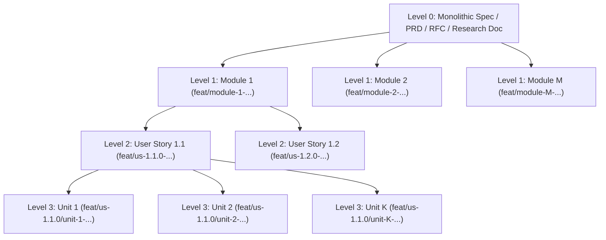
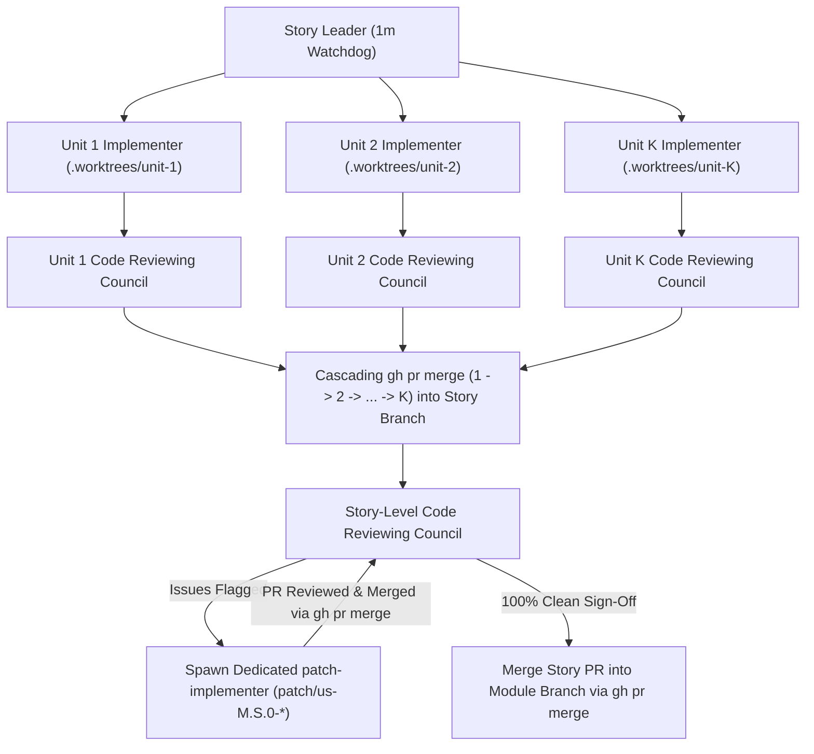

# divide-and-conqure-dev-plugin

<div align="center">

> **Autonomous Divide-and-Conquer Software Engineering Plugin for the Google Antigravity Marketplace.**  
> Transform monolithic specifications into parallel Modules, User Stories, and non-blocking Implementation Units inside isolated Git worktrees • Multi-Council Code Review • Mandatory `patch-implementer` Self-Correction • GitHub Projects Kanban • 283+ Pluggable Specialist Agents from `msitarzewski/agency-agents`

[](plugin.json)
[](plugin.json)
[](#token-consumption--gemini-flash-family-optimization)
[-22C55E.svg)](https://github.com/msitarzewski/agency-agents)
[](LICENSE)
[](https://github.com/sponsors/some-of-cs)

[Overview](#why-divide-and-conqure-dev-plugin) •
[Token & Model Guidance](#token-consumption--gemini-flash-family-optimization) •
[Prerequisites (`git` & `gh`)](#prerequisites-mandatory-git--gh-preflight-gate) •
[Monolith $\to$ Units Matrix](#from-monolithic-docs-to-non-blocking-implementation-units) •
[Parallel Architecture & `patch-implementer`](#parallel-execution-multi-council-review--patch-implementer-loop) •
[Agency Roster (283 Agents)](#choosing-your-project-agents-msitarzewskiagency-agents) •
[Quick Start](#installation--quick-start) •
[`some-stripe` Case Study](#real-world-case-study-some-stripe-v080) •
[Sponsors](#backers--corporate-sponsors)

</div>

---

## Why `divide-and-conqure-dev-plugin`?

Single-agent coding workflows break down on large specifications: context windows fill up with compiler noise, sequential task execution takes hours, unreviewed commits introduce regressions, and local status files (`KANBAN.md`) create endless merge conflicts.

**`divide-and-conqure-dev-plugin`** is a **language-, framework-, and product-agnostic** Google Antigravity plugin that turns any monolithic specification into a self-governing, parallel multi-agent software factory:

1. **Monolithic Docs $\to$ Modules $\to$ User Stories $\to$ Dynamic $K$ Implementation Units**:
   - Systematically decomposes huge PRDs, RFCs, or research documents into bounded **Modules**, cohesive **User Stories**, and a **dynamically calculated number ($K \in [1, N]$) of pure-implementation vertical slices** using a quantitative **Unit Sizing Decision Matrix**.
2. **100% Parallel, Non-Blocking Execution in Isolated `.worktrees/`**:
   - Every Implementation Unit is a **pure implementation slice** (never a validation-only unit waiting on siblings) with orthogonal file/module boundaries so **all $K$ units run simultaneously in parallel** inside `.worktrees/`.
3. **Concurrent Multi-Council Code Review & Mandatory `patch-implementer` Loop**:
   - Multiple independent **Code Reviewing Councils** run in parallel across Units, Stories, and Modules—auditing **Gate G0** (build/lint), **Gate G1** (test coverage), **Gate G2** (`security-audit`), **Gate G-Complexity** (`cyclomatic-complexity`), and **Gate G-Docs**.
   - Story and Module Leaders **never fix code directly in their own context**; any issue flagged by a Council automatically spawns an isolated **`patch-implementer`** subagent (`patch/*` branch & PR) in a continuous self-correction loop until 0 issues remain.
4. **GitHub Projects Visual Kanban & In-PR Conversation Audit Trail (Zero Local Report/Kanban Clutter)**:
   - Development status (`Todo`, `In Progress`, `In Review / PR Open`, `Merged`) is tracked visually in **GitHub Projects** (`gh project`) alongside a local `.agents/checkpoints/<module-id>/checkpoint.json`.
   - All Implementation Reports, Security Audits, Cyclomatic Complexity tables, and Council Sign-Offs are posted **directly as comments inside the GitHub Pull Request conversation (`gh pr comment`)** rather than cluttering the repository with local report files.
5. **Pluggable 283-Agent Specialist Roster ([`msitarzewski/agency-agents`](https://github.com/msitarzewski/agency-agents))**:
   - Choose the exact specialists your project needs from **all 18 divisions and 283 agents** of `msitarzewski/agency-agents`—whether you are building a Rust SDK, a TypeScript/React SaaS, a Python AI pipeline, a Go microservice, a mobile app, or a Unity/Unreal game.

---

## Token Consumption & Gemini Flash Family Optimization

> [!IMPORTANT]
> ### High Code Quality vs. High Token Consumption (Designed for the Gemini Flash Family)
> - **Extreme Output Quality**: By running $K$ parallel Unit Implementers, multiple concurrent Code Reviewing Councils (`security-audit` + `cyclomatic-complexity`), and automated `patch-implementer` remediation loops across every tier, this plugin produces **exceptionally high-quality, zero-warning, production-grade code and products**.
> - **High Token Consumption Trade-Off**: Because every unit, patch, story, and module undergoes full independent multi-agent implementation and multi-council verification, **this workflow consumes a large volume of tokens**.
> - **Primary Target — Gemini Flash Family**: This plugin is **mainly developed, tuned, and recommended for the Gemini Flash family** (such as `gemini-2.5-flash` and `gemini-3-flash`), which delivers the high speed, large context window, and token cost-efficiency required for parallel multi-agent swarms.
> - **Single-Profile Operation with `quota-sentinel`**: This plugin operates on **one profile at a time**. A dedicated autonomous **`quota-sentinel`** monitors token velocity and rate limits (`429` / `1%` remaining capacity), automatically flushing state to `.agents/checkpoints/<module-id>/checkpoint.json`, pausing active agents, and scheduling an automatic wakeup timer until your quota resets.

---

## Prerequisites: Mandatory `git` & `gh` Preflight Gate

Before the plugin starts any decomposition, worktree provisioning, or agent spawning, **Gate 0 (`scripts/preflight-check.sh`)** verifies that both **`git`** and **`gh` (GitHub CLI)** exist on `$PATH` and are authenticated:

| Prerequisite | Minimum Version | Why It Is Required Before Starting |
| :--- | :--- | :--- |
| **`git`** | `>= 2.30` | Provisions isolated `.worktrees/` for parallel Module, Story, Unit, and Patch agents. |
| **`gh` (GitHub CLI)** | `>= 2.30` | Creates PRs (`gh pr create`), posts in-conversation reports (`gh pr comment`), syncs GitHub Projects Kanban (`gh project`), and executes cascading merges (`gh pr merge`). |

Verify your environment at any time:

```bash
./scripts/preflight-check.sh
```

*(This check also runs automatically on `SessionStart` via [`hooks.json`](hooks.json). If either `git` or `gh` is missing, the plugin halts immediately before spawning any agents.)*

---

## From Monolithic Docs to Non-Blocking Implementation Units

The [`spec-decomposition`](skills/spec-decomposition/SKILL.md) skill provides a formal 4-level pipeline to turn any monolithic specification into parallel execution units:



### Dynamic Implementation Unit Sizing Matrix ($K$ Is Not Fixed at 5)

Implementation units per User Story **do not have to be 5**—a story can require fewer (e.g., 2 or 3) or more (e.g., 6, 7, or 8+) depending on its complexity and surface area. Calculate the **Story Decomposition Score ($S_{\text{story}}$)**:

| Dimension | Weight | Score = `1` (Low) | Score = `2` (Medium) | Score = `3` (High) | Score = `4` (Very High) |
| :--- | :---: | :--- | :--- | :--- | :--- |
| **$D_1$: Entities / Endpoints / Components** | **35%** | 1–2 items | 3–4 items | 5–6 items | 7+ items |
| **$D_2$: Estimated Production LOC** | **25%** | $< 300$ LOC | $300 - 700$ LOC | $700 - 1,400$ LOC | $> 1,400$ LOC |
| **$D_3$: Algorithmic / Protocol Complexity** | **20%** | Simple CRUD / UI | Validation / state machine | Crypto / streaming / dual-protocol | Concurrency / distributed state |
| **$D_4$: Natural Orthogonal Boundaries** | **20%** | 1–2 files/modules | 3–4 independent files/modules | 5–6 independent files/modules | 7+ independent files/modules |

$$S_{\text{story}} = 0.35 D_1 + 0.25 D_2 + 0.20 D_3 + 0.20 D_4$$

| Story Score ($S_{\text{story}}$) | Recommended Units ($K$) | Typical Story Profile |
| :---: | :---: | :--- |
| **$1.00 - 1.25$** | **1–2 Units** | Compact config, utility, or 2-component slice ($150-250$ LOC/unit) |
| **$1.26 - 2.00$** | **3 Units** | Focused domain model + service + handler/controller slice |
| **$2.01 - 2.55$** | **4 Units** | Medium multi-endpoint or full-stack feature slice |
| **$2.56 - 3.10$** | **5 Units** | Rich domain story (models, CRUD, streaming/pagination, lifecycle actions) |
| **$3.11 - 3.55$** | **6–7 Units** | Large subsystem spanning 6–7 orthogonal submodules |
| **$3.56 - 4.00$** | **8+ Units (or Split Story)** | Mega-story: partition into 8 parallel units or split into two User Stories |

### Two Non-Negotiable Unit Design Invariants

1. **Pure Implementation Only (Zero Validation-Only Units)**:
   - Every unit $1..K$ MUST implement production code plus its own unit tests.
   - **Never** create a unit whose purpose is *"Unit $K$: Write integration tests or validate Units $1..(K-1)$"*. Story-level integration testing is performed by the Story Leader after all $K$ units merge.
2. **Zero Inter-Unit Blocking (100% Parallel Execution)**:
   - Units $1..K$ own disjoint files/submodules (with any shared interfaces seeded on the story branch first) so **all $K$ Unit Implementers run simultaneously in parallel** without waiting on one another.

---

## Parallel Execution, Multi-Council Review & `patch-implementer` Loop



### How the 3-Tier Review & `patch-implementer` Loop Works

1. **Parallel Unit Councils**:
   - Each Unit Implementer ($1..K$) invokes its own independent **Code Reviewing Council** in parallel as soon as its PR opens. If any issue or high complexity ($CC > 10$) is found, the Unit Implementer fixes it and re-invokes the Council until `GATE G-REVIEW APPROVED` is posted in the PR conversation.
2. **Story-Level Review & Mandatory `patch-implementer`**:
   - Once Units $1..K$ merge into `feat/us-M.S.0-<slug>`, the Story Leader opens the Story PR and invokes a fresh Story-level **Code Reviewing Council**.
   - **Strict Invariant**: If ANY issue is found at the story level, the **Story Leader NEVER fixes code directly in its own context**. It spawns a dedicated **`patch-implementer`** subagent in `.worktrees/patch-us-M.S.0-<scope>`, opens a Patch PR, merges it into the story branch via `gh pr merge`, and re-invokes the Story Council until 0 problems remain.
3. **Module-Level Review & Mandatory `patch-implementer`**:
   - Once all User Stories merge into `feat/module-M-<slug>`, the Module Leader invokes a Module-level **Code Reviewing Council**. Any findings trigger a dedicated **`patch-implementer`** on `patch/module-M-<scope>` until 100% clean sign-off is achieved.
4. **End-of-Module Whole-Codebase Validation**:
   - After the Module PR merges into `main`, the Main Supervisor runs the entire repository's test suite, linter, formatter, and doctests across Modules $1..M$ with a Whole-Codebase Gatekeeper Council.

---

## Bundled Reviewing Council & Orchestration Skills

All skills used by the Orchestrators and Code Reviewing Councils are included in [`skills/`](skills/):

| Skill | Purpose & Enforced Thresholds |
| :--- | :--- |
| **[`preflight-git-gh`](skills/preflight-git-gh/SKILL.md)** | **Gate 0**: Verifies `git` ($\ge 2.30$), `gh`, and `gh auth status` before starting the plugin. |
| **[`spec-decomposition`](skills/spec-decomposition/SKILL.md)** | Decomposes monolithic docs into Modules, User Stories, and Dynamic $K$ non-blocking Units. |
| **[`divide-and-conquer-orchestrator`](skills/divide-and-conquer-orchestrator/SKILL.md)** | Manages parallel `.worktrees/`, 3m/1m watchdogs, streaming PRs, and cascading `gh pr merge`. |
| **[`code-review-council`](skills/code-review-council/SKILL.md)** | Runs parallel Multi-Council reviews (Gates G0, G1, G2, G-Complexity, G-Docs, G-Review) & `patch-implementer` loops. |
| **[`cyclomatic-complexity`](skills/cyclomatic-complexity/SKILL.md)** | **Gate G-Complexity**: Language-agnostic $CC = 1 + \sum \text{decision points}$ ($CC \le 6$ target, $\le 10$ ceiling, $>15$ hard merge blocker, nesting $\le 2$). |
| **[`security-audit`](skills/security-audit/SKILL.md)** | **Gate G2**: Constant-time crypto, secret redaction, payload bounds, OWASP Top 10, and statutory compliance audit. |
| **[`github-projects-kanban`](skills/github-projects-kanban/SKILL.md)** | Syncs visual Kanban status with **GitHub Projects** (`gh project`) + `.agents/checkpoints/` and posts all reports to **PR conversations**. |
| **[`agency-roster-selector`](skills/agency-roster-selector/SKILL.md)** | Interactive/CLI selector for all 283 agents across 18 divisions from `msitarzewski/agency-agents`. |

---

## Choosing Your Project Agents (`msitarzewski/agency-agents`)

Because `divide-and-conqure-dev-plugin` is completely generic across all languages and domains, it bundles **all 18 divisions and 283 specialist agents** from [`https://github.com/msitarzewski/agency-agents`](https://github.com/msitarzewski/agency-agents) under [`agents/agency-catalog/`](agents/agency-catalog/):

- **Engineering (66 agents)**: `backend-architect`, `frontend-developer`, `ai-engineer`, `devops-automator`, `database-optimizer`, `mobile-app-builder`, `api-platform-engineer`, `code-reviewer`, `git-workflow-master`, and more.
- **Security (12 agents)**: `application-security-engineer`, `ai-generated-code-security-auditor`, `penetration-tester`, `cloud-security-architect`, `compliance-auditor`, `cryptography-engineer`.
- **Testing (9 agents)**: `api-tester`, `performance-benchmarker`, `qa-automation-engineer`, `accessibility-auditor`, `test-results-analyzer`.
- **Design, Product, Project Management, Game Dev, Spatial Computing, Finance, Healthcare, GIS, Specialized, Research, Academic, Marketing, Paid Media, Sales, Support** (all 18 divisions included).

Browse and enable the exact agents your project needs:

```bash
# List all 18 divisions and agent counts
./scripts/select-agents.sh --list-divisions

# Search for specialists by technology or domain
./scripts/select-agents.sh --search "security"
./scripts/select-agents.sh --search "frontend"

# Enable specific divisions into your target project
./scripts/select-agents.sh --divisions engineering,security,testing --target /path/to/your/project

# Or enable specific individual agents by slug
./scripts/select-agents.sh --agents backend-architect,frontend-developer,application-security-engineer,api-tester --target /path/to/your/project

# Or enable ALL 283 agents across all 18 divisions
./scripts/select-agents.sh --all --target /path/to/your/project
```

---

## Installation & Quick Start

### 1. Install the Plugin into Your Project

```bash
# Clone the plugin
git clone https://github.com/some-of-cs/divide-and-conqure-dev-plugin.git
cd divide-and-conqure-dev-plugin

# Run the installer (automatically verifies git & gh exist before starting)
./scripts/install-plugin.sh \
  --target /path/to/your/project \
  --divisions engineering,security,testing
```

### 2. Initialize GitHub Projects Kanban & Checkpoint Store

```bash
cd /path/to/your/project
./scripts/gh-kanban-sync.sh init \
  --module module-1 \
  --title "Module 1: Core Platform" \
  --project-number 1
```

### 3. Prompt Google Antigravity (Recommended: Gemini Flash Family)

```text
Using the divide-and-conqure-dev-plugin rules and the spec-decomposition skill:
1. Run ./scripts/preflight-check.sh to verify git and gh are ready.
2. Decompose docs/SPECIFICATION.md into bounded Modules, User Stories, and dynamically sized, non-blocking Implementation Units (using the Unit Sizing Decision Matrix).
3. Sync the roadmap with our GitHub Project Kanban board and .agents/checkpoints/checkpoint.json.
4. Execute Module 1 by spawning parallel Story Leaders and Unit Implementers in .worktrees/, running parallel Code Reviewing Councils, using patch-implementer for any review findings, and posting all execution and review reports directly to the GitHub PR conversations.
```

---

## Real-World Case Study: `some-stripe` (`v0.8.0`)

See [`examples/some-stripe/`](examples/some-stripe/README.md) for the complete case study of how **[`some-stripe`](https://github.com/some-of-cs/some-stripe)**—an idiomatic Rust 2024 SDK and constant-time webhook engine for Stripe API v1 & v2—was built from a single monolithic research document using this exact workflow:

- **Input**: 1 monolithic specification (`Stripe Services and API Research.md`)
- **Output**: **8 Modules**, **16 User Stories**, **80 Parallel Implementation Units**, and **137 merged GitHub PRs**
- **Quality**: **705+ unit/wire tests**, **220+ runnable doctests**, **0 compiler/Clippy warnings**, **Max Cyclomatic Complexity $CC \le 6$** on primary paths, and **100% Gate G2 / Gate G-Law compliance**.

Explore the example artifacts:
- [Case Study Overview (`examples/some-stripe/README.md`)](examples/some-stripe/README.md)
- [Dynamic Unit Sizing Walkthrough (`examples/some-stripe/decomposition-walkthrough.md`)](examples/some-stripe/decomposition-walkthrough.md)
- [Sample In-PR Conversation Audit Reports (`examples/some-stripe/sample-pr-conversation-reports.md`)](examples/some-stripe/sample-pr-conversation-reports.md)
- [Sample Checkpoint Store (`examples/some-stripe/sample-checkpoint.json`)](examples/some-stripe/sample-checkpoint.json)

---

## Repository Structure

```text
divide-and-conqure-dev-plugin/
├── plugin.json                                     # Antigravity Marketplace Plugin Manifest
├── .antigravity-plugin/plugin.json                 # Loader alias manifest
├── .gemini-plugin/plugin.json                      # Gemini CLI plugin alias manifest
├── hooks.json                                      # SessionStart hook enforcing git & gh preflight check
├── rules/
│   ├── AGENTS.md                                   # Consolidated workspace governance rules (<24 KB)
│   └── references/                                 # Deep-dive reference guides (Rules 01..06)
├── skills/
│   ├── preflight-git-gh/SKILL.md                   # Gate 0: git & gh CLI verification
│   ├── spec-decomposition/SKILL.md                 # Monolith -> Modules -> Stories -> Dynamic K-Unit Matrix
│   ├── divide-and-conquer-orchestrator/SKILL.md    # Parallel .worktrees/ & cascading gh pr merge
│   ├── code-review-council/SKILL.md                # Multi-Council review & patch-implementer loop
│   ├── cyclomatic-complexity/SKILL.md              # Language-agnostic CC <= 6 target, <= 10 cap, >15 blocker
│   ├── security-audit/SKILL.md                     # Language-agnostic security & crypto audit (Gate G2)
│   ├── github-projects-kanban/SKILL.md             # GitHub Projects v2 Kanban + checkpoint.json + PR reports
│   └── agency-roster-selector/SKILL.md             # Selector for all 283 msitarzewski/agency-agents
├── agents/
│   ├── core/                                       # 7 core orchestration & council agent definitions
│   └── agency-catalog/                             # All 18 divisions & 283 agents from msitarzewski/agency-agents
├── scripts/
│   ├── preflight-check.sh                          # Verifies git and gh exist before starting
│   ├── install-plugin.sh                           # Installs plugin + chosen agents into a project
│   ├── select-agents.sh                            # Interactive/CLI selector for the 283 agency-agents
│   ├── gh-kanban-sync.sh                           # Syncs GitHub Projects Kanban & checkpoint.json
│   └── post-pr-report.sh                           # Posts Implementation & Council Reports to PR conversations
└── examples/
    └── some-stripe/                                # Real-world flagship case study (some-stripe v0.8.0)
```

---

## Backers & Corporate Sponsors

`divide-and-conqure-dev-plugin` is an independent, community-driven open-source project built for the Google Antigravity ecosystem. If your engineering team or company relies on this plugin to orchestrate autonomous multi-agent software delivery and automated code review councils, corporate sponsorship directly funds continuous maintenance, new orchestration skills, and expanded agent integrations.

<div align="center">

[](https://github.com/sponsors/some-of-cs)

</div>

### Corporate Sponsorship Tiers & Benefits

| Tier | Monthly | Placement & Benefits |
| :--- | :--- | :--- |
| **🏆 Visionary** | $1,000 / mo | Large logo on `README.md`, website, and Marketplace header • Prioritized GitHub issues • Dedicated quarterly workflow & agent architecture review |
| **🥇 Gold Partner** | $500 / mo | Prominent logo on `README.md` • Prioritized PR reviews • Direct issue escalation |
| **🥈 Silver Backer** | $150 / mo | Company logo, link, and mention in `README.md` and release changelogs |
| **☕ Individual** | $10 – $50 / mo | Listed as a contributor and backer on GitHub |

> [!TIP]
> **Need an Invoice or Procurement Documentation?**  
> We can issue formal VAT/sales-tax compliant invoices via Stripe Invoicing for corporate sponsors. Please contact [sponsors@someofcs.tech](mailto:sponsors@someofcs.tech).

---

## Acknowledgments & Special Thanks to `msitarzewski/agency-agents`

<div align="center">

### 🙏 Huge Thanks to [`msitarzewski/agency-agents`](https://github.com/msitarzewski/agency-agents)

[](https://github.com/msitarzewski/agency-agents)

</div>

A **massive thank you** to **[`@msitarzewski`](https://github.com/msitarzewski)** and all contributors to **[`https://github.com/msitarzewski/agency-agents`](https://github.com/msitarzewski/agency-agents)**!

`divide-and-conqure-dev-plugin` directly depends on **The Agency** (`msitarzewski/agency-agents`) for its pluggable roster of **283 specialist AI agents across 18 divisions** (`engineering`, `security`, `testing`, `design`, `product`, `project-management`, `game-development`, `spatial-computing`, `finance`, `healthcare`, `gis`, `specialized`, `research`, `academic`, `marketing`, `paid-media`, `sales`, and `support`). Without their comprehensive, battle-tested collection of specialist agent personas and Antigravity skill integrations, making this Divide-and-Conquer orchestration engine truly universal across every programming language, framework, and industry would not have been possible.

👉 **Please visit and star [`https://github.com/msitarzewski/agency-agents`](https://github.com/msitarzewski/agency-agents) to support their work!**

- Flagship real-world architectural validation powered by **[`some-stripe`](https://github.com/some-of-cs/some-stripe)** (`v0.8.0`).

---

## License

Licensed under the Apache License, Version 2.0 ([LICENSE](LICENSE)).
