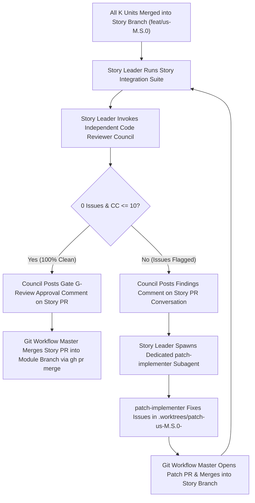

# Reference 04: Multi-Council Code Review & Mandatory `patch-implementer` Loop

## 1. Parallel Code Reviewing Councils

Multiple Code Reviewing Councils may run simultaneously across any number of active units, stories, or modules. Each Council is armed with:
- `skills/code-review-council/SKILL.md`
- `skills/security-audit/SKILL.md`
- `skills/cyclomatic-complexity/SKILL.md`
- Any project-specific domain/framework skills selected from `msitarzewski/agency-agents`.

## 2. The Mandatory `patch-implementer` Self-Correction Loop

At the **User Story** and **Module** tiers, leaders coordinate orchestration and **never directly edit production code in their own conversation context** when a Code Reviewing Council flags an issue.

### Why `patch-implementer` Is Mandatory
1. **Context Purity**: Keeps Story and Module Leaders lightweight and focused on orchestration rather than filling their context windows with file diffs and compiler output.
2. **Full Auditability**: Every post-merge remediation is isolated in its own atomic `patch/*` branch and PR with a dedicated in-PR report and review sign-off.
3. **Zero Silent Edits**: Prevents unreviewed ad-hoc commits from being pushed directly onto story or module branches after unit reviews have completed.
