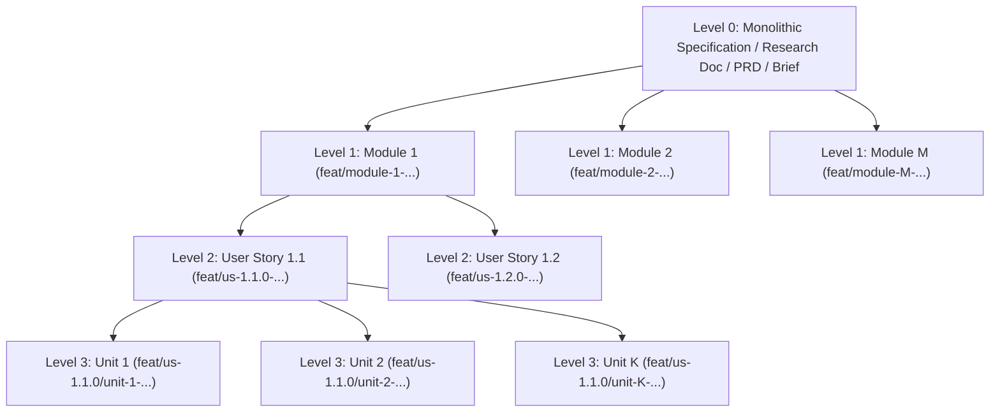

# Monolithic Specification Decomposition Skill

Use this skill whenever the user provides a monolithic specification, architecture RFC, product requirements document (PRD), financial model, marketing campaign brief, healthcare protocol, GIS pipeline, or research document and wants to build it using the **Divide-and-Conquer** workflow.

If `.agents/field-profile.json` exists in the workspace (or `--field <FIELD_PROFILE>` is passed), load the active field's sizing rubric from `profiles/fields.json` (default: `software`).

---

## 1. Four-Level Decomposition Hierarchy



### Level Definitions
1. **Level 1 — Modules (`module-1..M`)**:
   - **Scope**: Major architectural subsystems, domain bounded contexts, or workstreams (e.g., Core Runtime, Authentication, Billing Engine, Research Methodology, Campaign Funnel, Financial Statements).
   - **Rule**: Modules may have sequential phase dependencies or run in parallel if decoupled.
2. **Level 2 — User Stories / Deliverables (`us-M.1.0..us-M.S.0`)**:
   - **Scope**: Cohesive end-to-end feature or domain deliverables within a Module (typically 2 to 4 Stories per Module).
   - **Rule**: User Stories within a Module execute in parallel inside isolated `.worktrees/`.
3. **Level 3 — Implementation / Execution Units (`unit-1..K`)**:
   - **Scope**: Self-contained vertical deliverable slices within a User Story.
   - **Rule**: Every unit is a **pure deliverable production slice** (code + unit tests in software; drafted sections, models, or campaign assets + self-checks in non-software), and **all $K$ units run 100% in parallel without blocking one another**.

---

## 2. Dynamic Implementation Unit Sizing Matrix ($K \in [1, N]$)

> [!IMPORTANT]
> **Units Do NOT Have to Be 5**: Never force a User Story into an arbitrary 5-unit template if the story naturally decomposes into 2, 3, 4, 6, or 8 units. Always calculate the **Story Decomposition Score ($S_{\text{story}}$)** using the field-adapted matrix below to choose the exact number of units $K$.

### Step 2.1: Score the User Story Across 4 Dimensions ($D_1..D_4$)
Includes both **Code Metrics (`--field software|game-dev`)** and **Deliverable/Knowledge Metrics (`--field product|marketing|finance|research|healthcare|gis`)**:

| Dimension | Weight | Score = `1` | Score = `2` | Score = `3` | Score = `4` |
| :--- | :---: | :--- | :--- | :--- | :--- |
| **$D_1$: Functional / Deliverable Surface** *(endpoints/components or document sections/channels/models/hypotheses)* | **35%** | 1–2 distinct items | 3–4 distinct items | 5–6 distinct items | 7+ distinct items |
| **$D_2$: Artifact Volume** *(Production LOC or words/sheets/assets)* | **25%** | $< 300$ LOC *(or $< 1,000$ words / 1–2 sheets)* | $300 - 700$ LOC *(or $1,000 - 2,500$ words / 3–4 sheets)* | $700 - 1,400$ LOC *(or $2,500 - 5,000$ words / 5–6 sheets)* | $> 1,400$ LOC *(or $> 5,000$ words / 7+ sheets)* |
| **$D_3$: Logic / Analytical Complexity** *(Algorithmic or analytical/regulatory modeling)* | **20%** | Simple CRUD / static UI / narrative summary | Validation / state machine / structured synthesis | Crypto / streaming / dual-protocol / multi-scenario sensitivity | Concurrency / distributed consensus / multi-variable statistical or regulatory modeling |
| **$D_4$: Orthogonal File Boundaries** *(Independent files/modules/chapters)* | **20%** | 1–2 files/modules/chapters | 3–4 independent files/modules/chapters | 5–6 independent files/modules/chapters | 7+ independent files/modules/chapters |

Compute the weighted score:
$$S_{\text{story}} = (0.35 \times D_1) + (0.25 \times D_2) + (0.20 \times D_3) + (0.20 \times D_4)$$

### Step 2.2: Field-Specific $D_1$ & $D_2$ Reference Presets (`profiles/fields.json`)

| `--field` Flag | Auto-Enabled Divisions | $D_1$ (35% Surface) & $D_2$ (25% Volume) |
| :--- | :--- | :--- |
| **`software`** *(default)* | `engineering,security,testing` | **$D_1$**: Entities/endpoints; **$D_2$**: Production LOC (under 300 to over 1,400) |
| **`product`** | `product,design,project-management,research` | **$D_1$**: User flows/personas/screens; **$D_2$**: Spec depth (under 800 to over 4,000 words) |
| **`marketing`** | `marketing,paid-media,sales,design` | **$D_1$**: Channels/funnels/creatives; **$D_2$**: Asset count & copy volume |
| **`finance`** | `finance,specialized,support` | **$D_1$**: Models/statements/scenarios; **$D_2$**: Schedules, formulas & sensitivity tables |
| **`research`** | `academic,research,specialized` | **$D_1$**: Hypotheses/sections/datasets; **$D_2$**: Word count & citation density |
| **`healthcare`** | `healthcare,security,academic,support` | **$D_1$**: Clinical pathways/protocols; **$D_2$**: Evidence tables & regulatory modules |
| **`game-dev`** | `game-development,spatial-computing,design,testing` | **$D_1$**: Mechanics/systems/shaders/levels; **$D_2$**: Script LOC or scene asset count |
| **`gis`** | `gis,engineering,testing` | **$D_1$**: Layers/pipelines/projections; **$D_2$**: Spatial scripts & dataset schemas |

### Step 2.3: Map $S_{\text{story}}$ to Implementation Unit Count ($K$)

| Weighted Score ($S_{\text{story}}$) | Unit Count ($K$) | Sizing Rationale & Target Slice Size |
| :---: | :---: | :--- |
| **$1.00 - 1.25$** | **1–2 Units** | Micro-story: 1–2 small components ($150-250$ LOC or $400-800$ words per unit). Over-splitting would create trivial files. |
| **$1.26 - 2.00$** | **3 Units** | Compact story: 3 orthogonal slices (e.g., Entity Models, Service Operations, Event/Webhook Handler; or Literature, Methodology, Results). |
| **$2.01 - 2.55$** | **4 Units** | Medium story: 4 independent domain/deliverable slices ($200-350$ LOC or $800-1,200$ words per unit). |
| **$2.56 - 3.10$** | **5 Units** | Standard rich story: 5 vertical slices covering full domain, operations, streaming/pagination or multi-scenario analysis, and edge cases. |
| **$3.11 - 3.55$** | **6–7 Units** | Large story: 6–7 parallel slices across a wide API, UI, research, or modeling surface. |
| **$3.56 - 4.00$** | **8+ Units (or Split Story)** | Mega-story: Either partition into 8 orthogonal units or split into two separate User Stories (`us-M.S.0` and `us-M.(S+1).0`). |

---

## 3. Hard Invariants for Implementation Units

### Invariant A: Pure Deliverable Production Only (Zero Validation-Only Units)
- **Every unit $1..K$ MUST produce real primary artifacts** (production source code + unit tests in `--field software|game-dev`; drafted sections, financial models, protocols, spatial layers, or campaign assets + self-checks in non-software fields).
- **STRICTLY PROHIBITED**: Creating a blocking "review-only" or "validation-only" unit whose job is *"Unit $K$: Write integration tests / contract tests / peer review / benchmarks for Units $1..(K-1)$"*.
- **Why**: A validation-only unit cannot run until Units $1..(K-1)$ finish, turning a parallel pipeline into a sequential bottleneck. Story-wide integration and cross-unit verification belong to the **Story Leader** after all $K$ units merge into the story branch.

### Invariant B: Zero Inter-Unit Blocking (100% Parallel Execution)
- Units $1..K$ MUST NOT depend on unmerged artifacts from sibling units.
- **How to Achieve Zero Blocking**:
  1. **Disjoint File/Module Ownership**: Assign each unit its own dedicated files, submodules, or chapters (e.g., `unit-1` owns `customer.rs` or `01-revenue-schedule.md`, `unit-2` owns `subscription.rs` or `02-expense-model.md`).
  2. **Story Base Contract Seeding**: If units share a common trait, interface, schema, glossary, or base DTO, define that minimal stub/schema on the story branch (`feat/us-M.S.0-<slug>`) *before* branching `unit-1..K`.
  3. **Independent Verification**: Each unit's worktree MUST compile/validate and pass its unit checks independently without waiting for any sibling unit.

---

## 4. Mandatory Decomposition Output Artifacts: Architecture Roadmap + Per-Module User Stories Folder

Every decomposition run MUST produce **two synchronized documentation outputs** before spawning module/story leaders:

1. **Master Architecture Decomposition Roadmap**:
   - `docs/architecture/DECOMPOSITION_ROADMAP.md`
2. **Per-Module User Stories Directory Tree (`docs/user-stories/`)**:
   - Create a dedicated subfolder for **every Module (`module-1..M`)**, and inside each module folder, create a comprehensive specification document for **every User Story (`us-M.S.0`)** under that module:
   ```text
   docs/
   ├── architecture/
   │   └── DECOMPOSITION_ROADMAP.md
   └── user-stories/
       ├── module-1-<module-slug>/
       │   ├── README.md                           # Module 1 overview, story index & dependencies
       │   ├── us-1.1.0-<story-slug>.md            # Comprehensive Spec Kit & Security Gateway doc
       │   └── us-1.2.0-<story-slug>.md
       ├── module-2-<module-slug>/
       │   ├── README.md
       │   ├── us-2.1.0-<story-slug>.md
       │   └── us-2.2.0-<story-slug>.md
       └── module-M-<module-slug>/
           ├── README.md
           └── us-M.S.0-<story-slug>.md
   ```

---

## 5. Mandatory Template for Every User Story Document (`docs/user-stories/module-M-<slug>/us-M.S.0-<story-slug>.md`)

Every User Story document under `docs/user-stories/module-M-<slug>/` MUST include **at least** the following 6 major sections and all of their sub-sections:

```markdown
# User Story `US-M.S.0`: <User Story Title>

- **Module**: `module-M` (<Module Name>)
- **Story Branch**: `feat/us-M.S.0-<story-slug>`
- **Field Profile**: `<software|product|marketing|finance|research|healthcare|game-dev|gis>`
- **Story Decomposition Score ($S_{\text{story}}$)**: `<X.XX>` $\to$ **`<K>` Parallel Implementation Units (`unit-1..K`)**

---

## 1. Spec Kit Specifications

### 1.1 User Story Narrative
> **As a** <primary persona / actor>,  
> **I want** <capability, deliverable, or system behavior>,  
> **So that** <quantifiable business, engineering, or user value>.

Provide a detailed functional narrative explaining the context, boundaries, inputs, outputs, and deterministic behavior of this story.

#### 1.1.1 Preconditions
- List all required system states, upstream module contracts, environment configurations, permissions, or input artifacts that MUST hold true before this user story executes.

#### 1.1.2 Postconditions
- List all guaranteed state transitions, persisted records/files, emitted events, audit logs, and invariant guarantees that MUST hold true upon successful completion.

### 1.2 Acceptance Criteria (Gherkin Scenarios)
Write exhaustive, deterministic `Feature` / `Scenario` blocks in Gherkin syntax covering happy paths, edge/boundary cases, and error/rejection paths:

```gherkin
Feature: <User Story Feature Name>

  Scenario: AC-1 — <Primary Happy Path>
    Given <initial context / precondition>
    And <supporting state>
    When <actor triggers action / API / workflow>
    Then <expected primary outcome>
    And <expected postcondition / audit side-effect>

  Scenario: AC-2 — <Boundary / Edge Case>
    Given <boundary condition>
    When <action is executed>
    Then <deterministic handling>

  Scenario: AC-3 — <Invalid Input / Security / Failure Mode>
    Given <unauthorized, malformed, or out-of-bounds input>
    When <action is attempted>
    Then <explicit error / rejection with zero state corruption>
```

### 1.3 Test Cases & Traceability Matrix
Map every Acceptance Criterion (`AC-1..N`) to concrete Test Case IDs (`TC-1..N`), the owning Implementation Unit (`unit-1..K`), test level, and verification command:

| Test Case ID | Mapped AC | Owning Unit | Test Level (Unit / Integration / Property / Security) | Description & Input Vector | Expected Result & Pass Threshold |
| :--- | :---: | :---: | :---: | :--- | :--- |
| `TC-M.S.1` | `AC-1` | `unit-1` | Unit + Integration | <Test scenario & input> | <Deterministic assertion> |
| `TC-M.S.2` | `AC-2` | `unit-2` | Boundary / Edge | <Boundary input> | <Expected behavior> |
| `TC-M.S.3` | `AC-3` | `unit-K` | Security / Negative | <Adversarial / malformed input> | <Rejected with typed error, 0 leak> |

---

## 2. Technical Implementation Plan

### 2.1 Domain Invariants & Storage Schema
- **Domain Invariants**: List all non-negotiable domain rules, state-machine constraints, idempotency guarantees, concurrency rules, and validation bounds.
- **Storage Schema / Data Models / Artifact Schema**: Provide exact type definitions, database/table schemas, wire protocols, JSON schemas, or document/model structures introduced or updated by this story.

### 2.2 Activity Diagram *(or `### 2.2 Sequence Diagram` — choose ONE header that best represents this User Story)*
*(Rule: Select **either** `### 2.2 Activity Diagram` **or** `### 2.2 Sequence Diagram` depending on whether control-flow branching/parallel activities or multi-actor message passing better describes the story, and render a complete Mermaid diagram.)*

```mermaid
sequenceDiagram
    autonumber
    actor Actor as User / Caller
    participant API as Boundary / Handler (Unit 1)
    participant Core as Domain Service (Unit 2)
    participant Store as Storage / Ledger (Unit K)

    Actor->>API: Submit request / trigger workflow
    API->>API: Validate schema, auth & rate bounds
    API->>Core: Execute domain logic
    Core->>Store: Persist state transition atomically
    Store-->>Core: Confirm commit & audit record
    Core-->>API: Return typed result
    API-->>Actor: Deterministic response
```

---

## 3. Expected Folder Architecture at the Project

Show the exact project directory tree and file paths created or modified by this User Story, annotating which Implementation Unit (`unit-1..K`) owns each file to guarantee **100% disjoint file ownership**:

```text
<project-root>/
├── src/ (or domain deliverable root)
│   ├── <module-slug>/
│   │   ├── mod / index                  # Seeded on Story base branch (feat/us-M.S.0)
│   │   ├── <slice-1>                    # Owned exclusively by unit-1
│   │   ├── <slice-2>                    # Owned exclusively by unit-2
│   │   └── <slice-K>                    # Owned exclusively by unit-K
└── tests/
    └── <module-slug>/
        ├── test_<slice-1>               # Owned exclusively by unit-1
        ├── test_<slice-2>               # Owned exclusively by unit-2
        └── test_<slice-K>               # Owned exclusively by unit-K
```

---

## 4. Implementation Units in Detail & Specialist Agent Assignment

### 4.1 Story Decomposition Score ($S_{\text{story}}$) & Dynamic Unit Count ($K$)
- **$D_1$ (35% Surface)**: `<1..4>` — <justification>
- **$D_2$ (25% Volume)**: `<1..4>` — <justification>
- **$D_3$ (20% Complexity)**: `<1..4>` — <justification>
- **$D_4$ (20% Boundaries)**: `<1..4>` — <justification>
- **Calculated Score**: $S_{\text{story}} = 0.35(D_1) + 0.25(D_2) + 0.20(D_3) + 0.20(D_4) = \mathbf{<X.XX>}$ $\to$ **`<K>` Parallel Units**

### 4.2 Detailed Unit Specifications (`unit-1..K`)
For each unit `i` in `1..K` (all obeying **Invariant A: Pure Deliverable Production Only** and **Invariant B: Zero Inter-Unit Blocking**):
- **`unit-1` (`feat/us-M.S.0/unit-1-<scope>`)**:
  - **Deliverable Scope**: <exact functionality/artifact produced>
  - **Owned Files**: `<disjoint file list>`
  - **Public Contract / Exports**: `<types/functions/sections exposed>`
  - **Unit Verification & Target Complexity**: `<unit test suite>`, Max Cyclomatic Complexity $CC \le 6$ (cap $\le 10$, nesting $\le 2$)
- **`unit-2` (`feat/us-M.S.0/unit-2-<scope>`)**: ...
- **`unit-K` (`feat/us-M.S.0/unit-K-<scope>`)**: ...

### 4.3 Best-Fit Specialist Agents per Unit (`msitarzewski/agency-agents` + Core Roster)
Map each Implementation Unit and its Reviewing Council to the optimal specialist agent slugs from the bundled 283-agent catalog (`agents/agency-catalog/`):

| Unit ID | Branch Name | Primary Implementer Agent(s) (`agency-catalog`) | Reviewing Council Agent(s) | Mandatory Skills Enforced |
| :--- | :--- | :--- | :--- | :--- |
| `unit-1` | `feat/us-M.S.0/unit-1-<scope>` | `<e.g., backend-architect / rust-refactoring-specialist / financial-analyst>` | `code-reviewer`, `application-security-engineer`, `test-automation-engineer` | `code-review-council`, `security-audit`, `cyclomatic-complexity` |
| `unit-2` | `feat/us-M.S.0/unit-2-<scope>` | `<e.g., api-platform-engineer / frontend-developer / research-synthesist>` | `code-reviewer`, `security-architect`, `api-tester` | `code-review-council`, `security-audit`, `cyclomatic-complexity` |
| `unit-K` | `feat/us-M.S.0/unit-K-<scope>` | `<e.g., database-optimizer / ai-engineer / compliance-auditor>` | `code-reviewer`, `penetration-tester`, `reality-checker` | `code-review-council`, `security-audit`, `cyclomatic-complexity` |
| **Story Remediation** | `patch/us-M.S.0-<scope>` | `patch-implementer` + `<domain-specialist>` | `code-reviewer-council-president` | Full 6-Gate Re-Verification |

### 4.4 Parallel Execution & Zero-Blocking Contract Seeding Plan
1. **Base Contract Seeding**: List exact shared traits, interfaces, DTOs, or schemas committed to `feat/us-M.S.0-<slug>` *before* branching `unit-1..K`.
2. **Simultaneous Worktree Spawning**: All $K$ units are provisioned in `.worktrees/feat-us-M.S.0-unit-1..K` and spawned simultaneously in Step 1.
3. **Ordered Cascading Merge Sequence**: `unit-1` $\to$ `unit-2` $\to \dots \to$ `unit-K` into `feat/us-M.S.0-<slug>` via `gh pr merge <PR> --merge`.

---

## 5. Security Gateway (Powered by `security-audit` Skill)

### 5.1 Trust Boundaries & Security Actors
- **Security Actors**: Identify all human users, external API callers, internal subagents/services, privileged admins, and untrusted third-party webhooks/inputs.
- **Trust Boundaries**: Explicitly demarcate where untrusted data crosses into validated application/domain boundaries (network ingress, deserialization, auth token verification, file/storage I/O, cross-tenant boundaries).

### 5.2 Threat Modeling & Abuse Matrix (STRIDE / OWASP ASVS)

| Threat ID | STRIDE Category | ASVS / CWE Ref | Attack Vector / Abuse Scenario | Impact | Required Mitigation & Code/Deliverable Control |
| :--- | :---: | :---: | :--- | :---: | :--- |
| `TM-1` | **S**poofing | ASVS V2 / CWE-287 | Forged identity, token replay, or webhook spoofing | Critical | Constant-time signature/token verification + strict expiry/nonce check |
| `TM-2` | **T**ampering | ASVS V5 / CWE-20 | Malformed payload, injection, or schema mass-assignment | High | Strict allowlist schema validation, parameterized queries, immutable audit log |
| `TM-3` | **R**epudiation | ASVS V7 / CWE-778 | Unlogged state mutation or missing actor attribution | Medium | Tamper-evident structured audit event with actor ID, timestamp, and request hash |
| `TM-4` | **I**nformation Disclosure | ASVS V8 / CWE-200 | Secret/PII leak in logs, error stack traces, or responses | Critical | Automatic `[REDACTED]` debug/log scrubbing; zero raw internal errors exposed |
| `TM-5` | **D**enial of Service | ASVS V11 / CWE-400 | Unbounded payload size, regex backtracking, or resource exhaustion | High | Explicit payload byte limits, pagination caps, timeouts, and rate limiting |
| `TM-6` | **E**levation of Privilege | ASVS V4 / CWE-285 | Cross-tenant IDOR or missing role/scope authorization check | Critical | Mandatory tenant/actor scope enforcement on every read/write operation |

### 5.3 Cryptography & Global Data Protection Controls (Worldwide Legal & Regulatory Compliance)
To ensure this User Story can operate legally and securely **across all global jurisdictions**, enforce:
1. **Cryptographic Standards**:
   - **In Transit**: TLS 1.3+ (`HTTPS` / `mTLS`) for all network hops.
   - **At Rest**: AEAD encryption (`AES-256-GCM` or `ChaCha20-Poly1305`) for sensitive tokens, credentials, and regulated records.
   - **Signatures, Hashing & Secrets**: Constant-time comparison (`subtle::ConstantTimeEq` / `hmac.compare_digest` / `crypto.timingSafeEqual`) for all MACs/tokens; `SHA-256`/`SHA-512` or `Argon2id` for password/key derivation; zero hardcoded secrets or weak primitives (`MD5`/`SHA-1`).
2. **Global Multi-Jurisdictional Privacy & Legal Compliance (Worldwide Readiness)**:
   - **EU / EEA & UK (`GDPR` / `UK GDPR`)**: Data minimization, purpose limitation, lawful basis tracking, Right to Erasure / Right to Portability hooks (`delete_subject_data` / `export_subject_data`), and strict PII redaction in telemetry.
   - **United States (`CCPA`/`CPRA`, `HIPAA` for PHI, `GLBA`/`SOX` for financial, `COPPA`)**: Opt-out/consent flags, PHI/PII access audit trails, and strict separation of financial/health identifiers.
   - **Global Regional Frameworks (`Brazil LGPD`, `Singapore PDPA`, `Japan APPI`, `China PIPL`, `Canada PIPEDA`, `Australia Privacy Act`, `PCI-DSS v4.0`)**:
     - **Data Residency & Sovereignty**: Configurable region/tenant storage partitioning (`region_code` / `data_residency_zone`) so regulated data never crosses prohibited jurisdictional borders without explicit consent/transfer mechanisms.
     - **Universal PII/Secret Redaction**: Automatic redaction of personal names, emails, national IDs, payment instruments (PAN/CVV), and auth tokens from all logs, traces, and analytics across every locale (`UTF-8` / `i18n` safe).

### 5.4 Automated Security Verification Checklist (`cloudflare/security-audit-skill`)
- [ ] Applicable `skills/security-audit/playbooks/` reviewed (`WEB-PROTOCOL-AND-AUTH.md`, `AI-AND-LLM.md`, `MEMORY-SAFETY-AND-BINARY.md`, `CLOUD-AND-DEPLOYMENT.md`, `SUPPLY-CHAIN-AND-RELEASE.md`, etc.).
- [ ] All untrusted inputs validated for type, length, range, and encoding prior to domain processing.
- [ ] Zero secrets, API keys, private keys, or raw PII emitted in `Debug` formatting, logs, or error messages.
- [ ] Security coverage ledger and findings validated via `node skills/security-audit/validate-findings.cjs` and `node skills/security-audit/validate-coverage-ledger.cjs`.

### 5.5 Security Gateway (Gate G2) Sign-Off Checklist
- [ ] **0 Critical / High / Medium** vulnerabilities in `security-audit` scan.
- [ ] All STRIDE / ASVS threat mitigations (`TM-1..TM-6`) implemented and covered by negative/security test cases in Section 1.3.
- [ ] Global data protection, residency partitioning, and PII/secret redaction controls verified.
- [ ] Independent Security Reviewer agent sign-off posted to the GitHub PR conversation.

---

## 6. Validation Gates & Acceptance Sign-Off

Every Unit PR (`feat/us-M.S.0/unit-1..K`) and the parent Story PR (`feat/us-M.S.0-<slug>`) MUST pass all 6 Quality Gates and post the evidence directly to the GitHub PR conversation (`./scripts/post-pr-report.sh`) before `gh pr merge`:

| Gate | Gate Name | Pass Criteria for `US-M.S.0` | Verification Command / Evidence | Status |
| :--- | :--- | :--- | :--- | :---: |
| **Gate G0** | **Build, Lint & Format / Schema** | 0 errors, 0 warnings, 100% formatter / schema compliance | `<build & lint command>` | `[ ]` |
| **Gate G1** | **Tests, Coverage & Traceability** | 100% of `AC-1..N` and `TC-M.S.1..N` passing ($\ge 90\%$ line, $\ge 85\%$ branch coverage) | `<test runner command>` | `[ ]` |
| **Gate G2** | **Security Gateway (`security-audit`)** | All Section 5 STRIDE, crypto, and global compliance checks pass (0 findings) | `security-audit` report on PR | `[ ]` |
| **Gate G-Complexity** | **Cyclomatic / Structural Complexity** | Every function $CC \le 6$ target ($CC \le 10$ ceiling, $CC > 15$ blocker, nesting $\le 2$) | `cyclomatic-complexity` table on PR | `[ ]` |
| **Gate G-Docs** | **Documentation & Examples** | 100% public symbols/interfaces documented + runnable examples + this spec synced | `<doc check command>` | `[ ]` |
| **Gate G-Review** | **Council President Sign-Off** | Independent Reviewing Council posts `GATE G-REVIEW APPROVED` on GitHub PR | `gh pr comment <PR>` | `[ ]` |

### Final Acceptance Sign-Off Block
- **Story Leader Verification**: All $K$ units merged via cascading `gh pr merge`, story integration suite green, and zero unaddressed findings (or remediated via dedicated `patch-implementer` PRs).
- **Reviewing Council Verdict**: `PENDING` $\to$ `GATE G-REVIEW APPROVED`
```

---

## 6. Execution Sequence After Generating Roadmap & User Story Docs

1. Write `docs/architecture/DECOMPOSITION_ROADMAP.md`.
2. Create `docs/user-stories/module-M-<slug>/README.md` and `docs/user-stories/module-M-<slug>/us-M.S.0-<story-slug>.md` for every Module and User Story using the mandatory 6-section template in Section 5.
3. Run `${CLAUDE_PLUGIN_ROOT:-${ANTIGRAVITY_PLUGIN_ROOT:-.}}/scripts/gh-kanban-sync.sh init` to populate all Modules, User Stories, and Implementation Units on the **GitHub Projects Kanban board** and initialize `.agents/checkpoints/<module-id>/checkpoint.json`.
